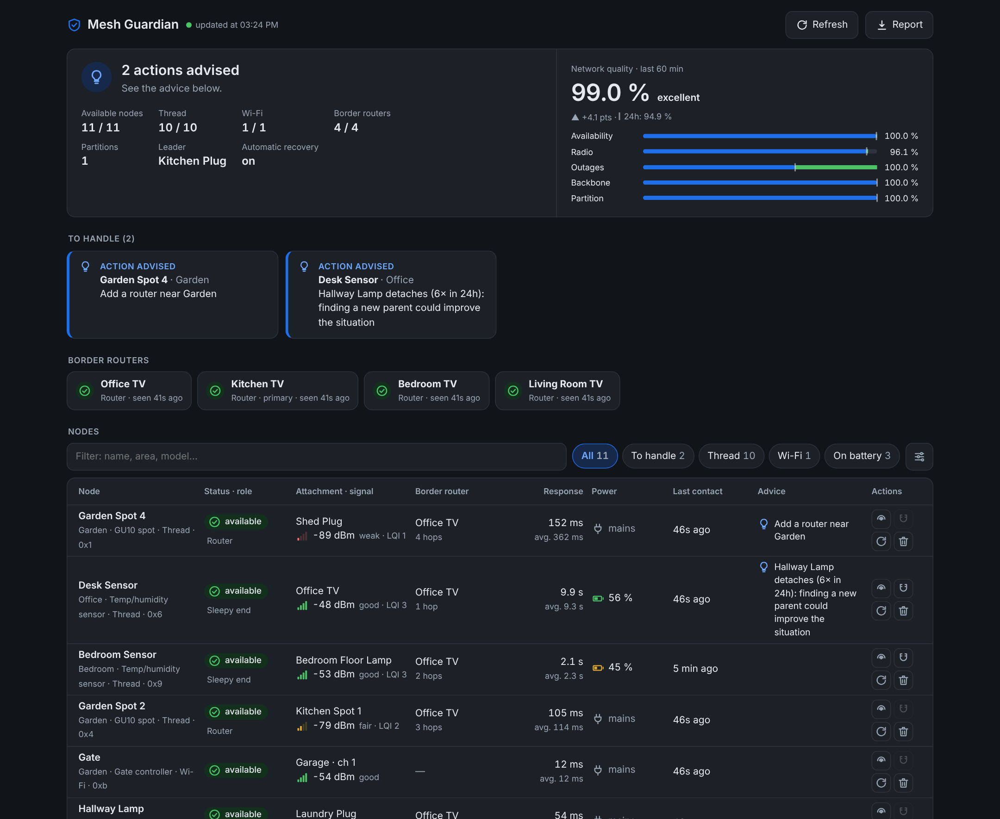

# Home Assistant add-ons by Pintjes

[![Add repository to my Home Assistant][repo-badge]][repo-link]
[![CI][ci-badge]][ci-link]

Add-on repository for [Home Assistant](https://www.home-assistant.io/).

  

## Add-ons

| | Add-on | Version | Description |
|:-:|---|:-:|---|
|  | **[Mesh Guardian](mesh_guardian/)** | ![version][mg-version] | Keeps your Thread / Matter devices online: automatic recovery of lost nodes, a live table of every node, border router monitoring and radio advice. |
|  | **[Voice Agent Bridge](voice_agent_bridge/)** | ![version][vab-version] | Talk to Claude through Assist and your voice satellites, with your Claude plan (no API key), the full Home Assistant toolset and a conversation panel. |

## Installation

1. Click the button below, or add `https://github.com/Pintjes/ha-addons` in
   **Settings → Add-ons → Add-on store → ⋮ → Repositories**.

   [![Add repository to my Home Assistant][repo-badge]][repo-link]

2. Find the add-on in the store and click **Install**.

## Support

Something wrong, or an idea? [Open an issue](https://github.com/Pintjes/ha-addons/issues/new/choose).

## License

[GPL-3.0](LICENSE) © Pintjes

These add-ons are independent projects, not affiliated with or endorsed by Anthropic, the Connectivity Standards Alliance or the Thread Group.

[repo-badge]: https://my.home-assistant.io/badges/supervisor_add_addon_repository.svg
[repo-link]: https://my.home-assistant.io/redirect/supervisor_add_addon_repository/?repository_url=https%3A%2F%2Fgithub.com%2FPintjes%2Fha-addons
[ci-badge]: https://github.com/Pintjes/ha-addons/actions/workflows/ci.yml/badge.svg
[ci-link]: https://github.com/Pintjes/ha-addons/actions/workflows/ci.yml
[mg-version]: https://img.shields.io/badge/dynamic/yaml?url=https%3A%2F%2Fraw.githubusercontent.com%2FPintjes%2Fha-addons%2Fmain%2Fmesh_guardian%2Fconfig.yaml&query=%24.version&label=&color=blue
[vab-version]: https://img.shields.io/badge/dynamic/yaml?url=https%3A%2F%2Fraw.githubusercontent.com%2FPintjes%2Fha-addons%2Fmain%2Fvoice_agent_bridge%2Fconfig.yaml&query=%24.version&label=&color=blue
